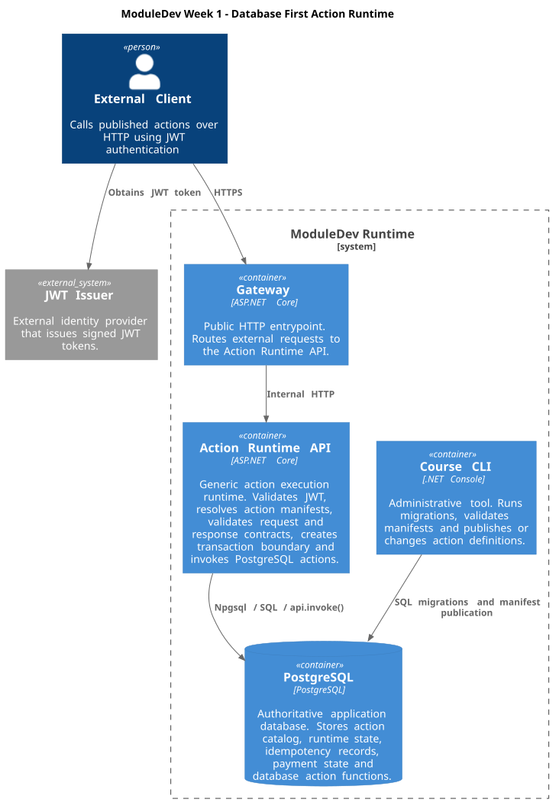

## Решение

### Архитектура

Проект реализует database-first action runtime, который публикует PostgreSQL-функции как HTTP actions через generic C# runtime.

Система состоит из четырёх сервисов:

- `gateway` — внешний HTTP gateway. Единственный сервис с опубликованным host-портом. Принимает внешние запросы, выполняет маршрутизацию и передаёт запросы во внутренний API.
- `api` — внутренний action runtime. Выполняет JWT-проверку, формирует server-side context, разрешает action через manifest, проверяет схемы и выполняет транзакцию..
- `cli` — сервис публикации и миграций. Выполняет применение миграций и команды управления action catalog.
- `postgres` — хранилище авторитетного состояния системы. Содержит action catalog, idempotency state, operations, events и runtime functions.

Направление вызовов:

- внешний клиент обращается только к `gateway`;
- `gateway` обращается к `api` через Compose DNS;
- `api` обращается к PostgreSQL через runtime database role;
- `cli` использует отдельные migration credentials.

Предметные действия не реализованы отдельными C# контроллерами. Новый action добавляется через manifest и регистрацию PostgreSQL-функции без изменения и пересборки `gateway` и `api`.

Документы архитектуры:

- [ADR-001: Trust Boundary](docs/adr/001-trust-boundary.md)
- [ADR-002: Technical Result and Domain Result](docs/adr/002-technical-vs-domain-result.md)

Диаграмма контейнеров (C4 Container Diagram):



### Запуск

#### Prerequisites

Для запуска необходимы:

- Docker;
- Docker Compose.

Перед первым запуском необходимо создать файл `.env` на основе `.env.example`.

Пример:

```bash
cp .env.example .env
```

После настройки переменных запуск выполняется из корня проекта:

```bash
docker compose up -d --build
```

После успешного запуска:

- `gateway` доступен по адресу:

```text
http://localhost:8080
```

- PostgreSQL работает во внутренней сети Compose;
- сервисы `api`, `cli` и `postgres` не публикуют host-порты.

Проверить состояние контейнеров:

```bash
docker compose ps
```

Полная автоматическая проверка:

```bash
./check.sh
```

### Конфигурация

Конфигурация передаётся через файл `.env`.

В репозитории хранится только пример конфигурации:

```text
.env.example
```

Перед запуском необходимо создать собственный `.env` файл на основе примера.

Реальные секреты не хранятся в Git.

Используемые переменные:

| Переменная                  | Назначение                                                                    |
| --------------------------- | ----------------------------------------------------------------------------- |
| `POSTGRES_PASSWORD`         | Пароль PostgreSQL superuser для инициализации базы данных `course`            |
| `COURSE_MIGRATOR_PASSWORD`  | Пароль роли миграций `course_migrator`                                        |
| `COURSE_PUBLISHER_PASSWORD` | Пароль роли публикации action manifests                                       |
| `COURSE_RUNTIME_PASSWORD`   | Пароль runtime-роли `course_runtime`, используемой API для выполнения actions |
| `COURSE_JWT_SIGNING_KEY`    | Секрет подписи JWT HS256. Должен содержать не менее 32 байт                   |
| `COURSE_JWT_ISSUER`         | Значение issuer для проверки JWT. Используется `moduledev-course`             |
| `COURSE_JWT_AUDIENCE`       | Значение audience для проверки JWT. Используется `moduledev-api`              |

Дополнительные настройки API задаются через `compose.yaml`.

API получает:

| Переменная        | Значение         |
| ----------------- | ---------------- |
| `ASPNETCORE_URLS` | `http://+:8080`  |
| `DB_HOST`         | `postgres`       |
| `DB_PORT`         | `5432`           |
| `DB_NAME`         | `course`         |
| `DB_USER`         | `course_runtime` |

Gateway получает:

| Переменная        | Значение          |
| ----------------- | ----------------- |
| `ASPNETCORE_URLS` | `http://+:8080`   |
| `API_BASE_URL`    | `http://api:8080` |

CLI получает отдельные credentials миграционной роли и не использует runtime-доступ API к базе данных.

### Миграции

Миграции хранятся в:

```text
db/migrations
```

Они применяются сервисом `cli`.

При стандартном запуске Compose выполняется миграционная инициализация через CLI.

Также миграции можно применить вручную:

Linux/macOS:

```bash
./course.sh migration apply /migrations
```

Windows:

```cmd
.\course.cmd migration apply /migrations
```

Через Docker Compose:

```bash
docker compose run --rm cli migration apply /migrations
```

Правила миграций:

- SQL-файлы выполняются в лексикографическом порядке;
- каждый migration file выполняется в отдельной транзакции;
- повторное применение неизменённой миграции является безопасным;
- изменение уже применённой миграции определяется через checksum и приводит к ошибке.

API runtime не использует migration credentials.

### Проверка

Основная автоматическая проверка решения выполняется нормативным black-box checker:

| Среда              | Команда       | Результат                                                                                                                                |
| ------------------ | ------------- | ---------------------------------------------------------------------------------------------------------------------------------------- |
| Unix/Linux/macOS   | `./check.sh`  | Запускает нормативный black-box checker. После завершения в корне проекта создаётся `week-1-public-report.json` с результатами проверки. |
| Windows PowerShell | `.\check.ps1` | Запускает тот же нормативный black-box checker и создаёт тот же `week-1-public-report.json`.                                             |

Оба скрипта запускают один и тот же `autocheck/public_check.py`; различается только способ запуска в зависимости от операционной системы.

Проверка использует собственные тестовые JWT и fixtures и является основным критерием корректности реализации.

Для ручной проверки database-first publication можно использовать демонстрационный action `test.echo`, расположенный в `contracts/example/test-echo-v1.action.json`.

| Команды                                                                                                                                                                                                    | Ожидаемый результат                                                                                                                                                                                                               |
| ---------------------------------------------------------------------------------------------------------------------------------------------------------------------------------------------------------- | --------------------------------------------------------------------------------------------------------------------------------------------------------------------------------------------------------------------------------- |
| **Unix/Linux/macOS**<br>`./course.sh action validate /app/contracts/example/test-echo-v1.action.json`<br><br>**Windows**<br>`.\course.cmd action validate /app/contracts/example/test-echo-v1.action.json` | `json { "status": "ok", "result": { "resource": "action", "operation": "validated" }, "meta": { "contractVersion": "course-1" } } `                                                                                               |
| **Unix/Linux/macOS**<br>`./course.sh action publish /app/contracts/example/test-echo-v1.action.json`<br><br>**Windows**<br>`.\course.cmd action publish /app/contracts/example/test-echo-v1.action.json`   | `json { "status": "ok", "result": { "resource": "action", "operation": "published", "key": "test.echo", "version": 1 }, "meta": { "contractVersion": "course-1" } } `                                                             |
| **Unix/Linux/macOS**<br>`./course.sh action activate test.echo --version 1`<br><br>**Windows**<br>`.\course.cmd action activate test.echo --version 1`                                                     | `json { "status": "ok", "result": { "resource": "action", "operation": "activated", "key": "test.echo", "version": 1 }, "meta": { "contractVersion": "course-1" } } `                                                             |
| **Unix/Linux/macOS**<br>`./course.sh action list`<br><br>**Windows**<br>`.\course.cmd action list`                                                                                                         | `json { "status": "ok", "result": { "resource": "actions", "count": 3, "items": [ ... { "module": "test", "action": "echo", "version": 1, "enabled": true, "isDefault": true } ] }, "meta": { "contractVersion": "course-1" } } ` |

CLI команды:

Проверка manifest без изменения состояния:

```bash
./course.sh action validate <manifest>
```

Публикация action:

```bash
./course.sh action publish <manifest>
```

Список опубликованных actions:

```bash
./course.sh action list
```

Активация версии:

```bash
./course.sh action activate <module.action> --version <version>
```

Отключение версии:

```bash
./course.sh action disable <module.action> --version <version> [--replacement-version <version>]
```

### Диагностика

Статус сервисов:

```bash
docker compose ps
```

Логи gateway:

```bash
docker compose logs gateway
```

Логи API:

```bash
docker compose logs api
```

Логи CLI:

```bash
docker compose logs cli
```

Подключение к PostgreSQL:

```bash
docker compose exec postgres psql -U postgres -d course
```

Health endpoints:

Проверка процесса API:

```text
GET /health/live
```

Проверка готовности системы:

```text
GET /health/ready
```

Readiness считается успешным только если:

- PostgreSQL доступен;
- завершена инициализация runtime.

OpenAPI:

Общий документ опубликованных default actions:

```text
GET /openapi/default.json
```

Документ конкретной версии action:

```text
GET /openapi/actions/{module}/{action}/{version}.json
```

OpenAPI документы строятся на основе опубликованных manifest.

### Ограничения

В текущей реализации поддерживается только функциональность первой недели задания.

Не реализованы:

- workflow engine;
- process instances;
- worker execution;
- provider simulator;
- retries;
- outbox/inbox;
- manual actions;
- failpoints и сложные механизмы восстановления.

Технические решения:

- PostgreSQL является источником авторитетного состояния;
- action execution выполняется через manifest-driven runtime;
- предметная логика находится в PostgreSQL-функциях;
- C# API отвечает за инфраструктурные проверки и выполнение контракта;
- gateway не содержит бизнес-логики и доступа к базе данных;
- publication и runtime используют разные database roles.

* [TASK.md](docs/TASK.md)
